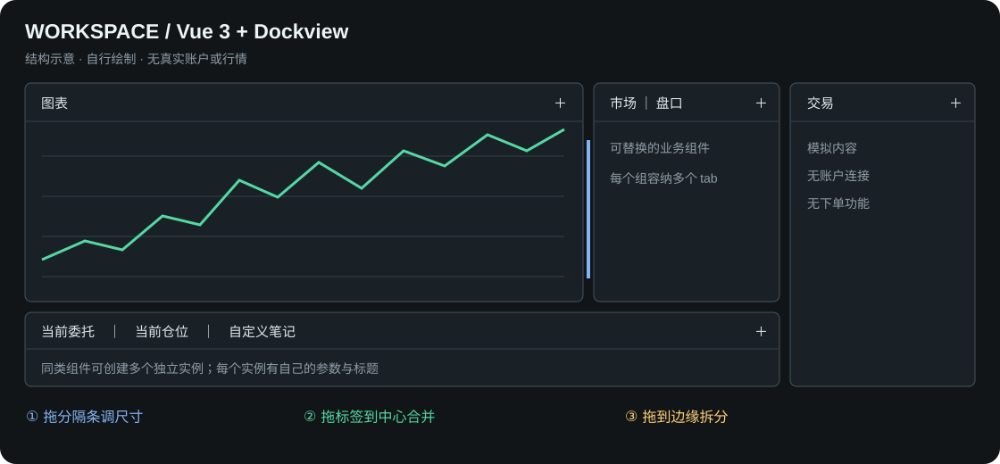

# Vue 3 可定制交易工作台

参考 OKX 交易界面交互制作的独立示例。采用 **Vue 3 + dockview-vue 8.9.1**，不是 OKX 原代码，也不表示 OKX 使用 Dockview。OKX 前端技术研究与本示例实现相互独立。

📖 [图文研究文档：官网证据、架构、拖拽与 Vue 实现](docs/OKX布局逆向分析与Vue实现.md)



## 启动

需要 Node.js 20.19+ 或 22.12+（开发时 Node 24）。

```sh
npm ci
npm run dev
```
打开终端显示的本地地址（默认 http://127.0.0.1:5173）。生产构建 `npm run build`，预览 `npm run preview`。构建后生成的 `dist/` 可部署到静态服务器；仓库不提交构建产物。

## 交互

- 拖动标签到另一组中央：合并为同组标签；拖动标签到边缘：拆分为新面板。
- 拖动组间分隔线：改变面板尺寸；关闭标签：移除该内容实例。
- 点击组右上角「＋」：向对应组添加任意内容组件；全局「添加组件」添加到当前组。
- 「编辑当前标签」：独立修改标签名称和内容类型。
- 「自定义笔记」：输入文字并持久化；同类型可以有多个独立实例。
- 自动把布局、标签、内容参数保存在 localStorage；刷新可恢复。
- 「导出布局」下载 JSON；「重置」恢复默认工作台。

## 结构

- `src/App.vue`：DockviewApi、默认布局、组件注册、编辑弹窗、保存和恢复。
- `src/PanelContent.vue`：示例组件内容。新增真实业务组件时，建议拆成独立 Vue SFC，并使用 Dockview `components` 注册表或 `#panel-*` 插槽映射。
- `src/style.css`：与布局模型独立的主题 tokens、Dockview 样式和交互高亮。
- `tests/workspace.spec.js`：浏览器回归测试（创建、编辑、笔记、刷新恢复、重置）。

当前深色主题以 [BingX BTCUSDT 永续合约页](https://bingx.com/zh-tc/perpetual/BTC-USDT) 的公开界面配色为参考：操作蓝 `#0F5FFF`，涨绿 `#27AD75`，跌红 `#F0616D`。示例不使用 BingX 标志，不是官方产品，也不连接 BingX 或 OKX 账户。

布局引擎管理 split/group/tab；Vue 管理业务内容，避免自己重写碰撞检测、拖放命中和分隔线。保存使用 `api.toJSON()`，恢复使用 `api.fromJSON()`。后续接入 Nuxt 时放在 `<ClientOnly>`，本地存储只在客户端读取，行情订阅应在组件卸载时注销。

## 校验状态和限制

- `npm run build`：通过，已生成 dist。
- Chromium 浏览器实测已通过：标签跨组移动（内容同步）、边缘拆分、分隔条 resize 和刷新持久化。修复了 DockviewVue 外层未明确高度导致面板仅 100px 的问题。
- 30 标签 / 20 次真实指针拖拽压测三轮通过，rAF p95 16.7–16.8ms，长任务 0。环境是 SwiftShader 软件渲染、静态模拟内容，不代表物理 GPU 或生产行情性能。详见 [性能测试与限制](docs/performance-testing.md)。
- 拖放合并、边缘拆分、尺寸调整由 Dockview 内建支持；真实鼠标自动化见 `tests/perf/drag.spec.js`，目标硬件及触屏仍需单独验收。
- 全部行情、订单、仓位为静态模拟数据。交易按钮禁用；没有 OKX 登录、API 密钥、网络下单。
- 非像素级复刻，未实现真实 K 线、交易引擎、账户云端同步、导入 JSON、多工作区或触屏专项测试。
- 存储采用版本号和异常回退；若对不可信 JSON 开放导入，应另加 schema 校验、组件白名单、迁移及大小限制。

## 在本机运行测试

```sh
npm ci
npx playwright install chromium
npm test
```

测试会自动启动 `127.0.0.1:5173` 的开发服务器；本机已有服务器时会复用（CI 不复用）。Linux 如缺少浏览器系统依赖，请按 Playwright 安装提示处理。

## 许可

本项目原创代码与文档采用 [MIT License](LICENSE)，Copyright (c) 2026 rubygba。第三方依赖遵循各自许可证。项目与 OKX 无隶属关系，也未复制其完整业务源码。

## 主要参考

- https://github.com/dockview/dockview
- https://github.com/dockview/dockview/blob/master/packages/dockview-vue/README.md
- https://dockview.dev/docs/core/overview/

项目仅使用社区包。依赖许可见 node_modules 内的许可证；Dockview 社区代码采用 MIT，企业功能需独立核查许可，本示例未使用企业包。
