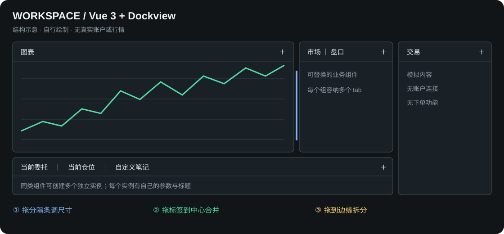
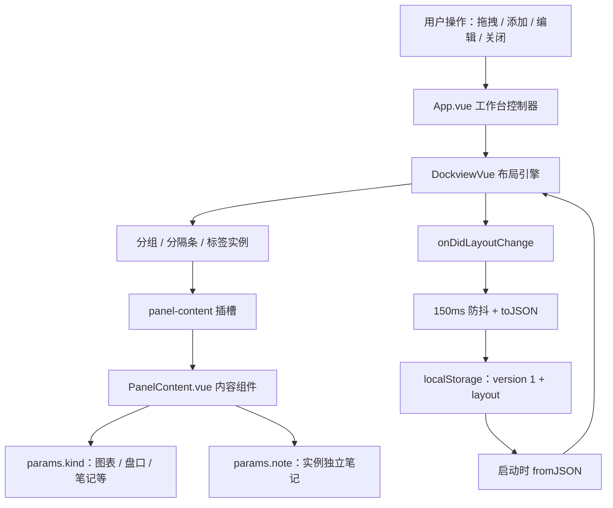
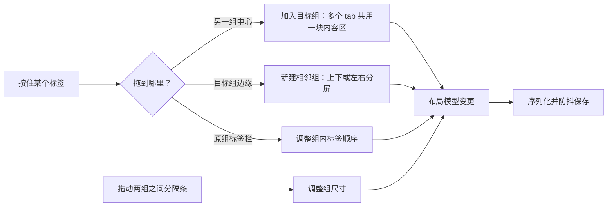

# OKX 可定制交易布局：源码证据与 Vue 3 实现

> 检查日期：2026-11-18。本文把「OKX 实际技术」与「独立 Vue 示例」分开说明。示例没有 OKX 登录、账户连接或真实交易功能；所有数字均为模拟数据。图示为自行绘制，不包含用户截图或账户信息。

## 1. 先看结论

**当前检查到的 OKX 交易页，使用 FlexLayout React 核心实现面板停靠、标签分组与布局模型，外层由 OKX 自己实现业务模块和定制交互。** 不是纯自研，也不是装上一个开源库就得到完整交易终端。

**本项目采用 Vue 3 + Dockview Vue，复现相同类别的交互，不是 OKX 原代码移植，也不代表 OKX 使用 Dockview。** 两者都属于 docking layout：标签可组成分组、分组可沿边缘拆分，分隔条调整尺寸。它不同于仅提供 `x/y/w/h` 的普通拖拽网格。

| 层次 | OKX 官方产物中的证据 | 本示例 |
|---|---|---|
| 布局引擎 | FlexLayout 类、模型及实际 `Layout` 调用 | `dockview-vue@8.9.1` |
| 标签与分组 | `onRenderTab`、`onRenderTabSet`、跨容器和拆分开关 | Dockview 标签/分组；组右侧「＋」 |
| 内容注册 | KLine、Account、MarketList、PlaceOrder 等 | 图表、盘口、成交、市场、订单、仓位、交易、笔记 |
| 应用状态 | 工作区、布局版本、组件能力和业务状态 | 本机版本化 JSON、150ms 防抖保存 |
| 交易数据 | OKX 自身业务，不属于布局库 | 静态模拟数据，交易按钮禁用 |



## 2. 官网证据链

### 2.1 从入口到实际模块调用

公开入口：[OKX BTC/USDT 现货交易页](https://www.okx.com/trade-spot/btc-usdt)。直接下载 HTML 后，读取其中 `script src`，发现以下官方 CDN 产物。调查不需要伪造登录，也未更改账户。

| 官方产物 | 作用 | 取证内容 |
|---|---|---|
| [20200/index.ef30c4ef.js](https://www.okx.com/cdn/assets/okfe/comb-trade/20200/index.ef30c4ef.js) | 布局核心代码 | `flexlayout__tabset`、`flexlayout__border` 等类及模型实现 |
| [22309/index.8ac3fe4c.js](https://www.okx.com/cdn/assets/okfe/comb-trade/22309/index.8ac3fe4c.js) | 交易布局业务接入 | 实际 `Layout` 渲染、内容工厂、添加/删除模块、布局序列化 |
| [okex/index.50b03573.js](https://www.okx.com/cdn/assets/okfe/comb-trade/okex/index.50b03573.js) | 交易页整合 | 对 `.flexlayout__tabset_tabbar_outer` 等实际容器的事件处理 |

这不是只凭类名推测，也不是“某个 bundle 恰好带了一个未使用依赖”：**22309 中有实际业务调用。** 以下对压缩变量做了少量可读化，仅展示调用结构，不是完整 OKX 源码：

```js
jsx(Layout, {
  model,
  realtimeResize: true,
  classNameMapper,
  factory,
  onAction,
  onModelChange,
  onRenderTab,
  onRenderTabSet,
})
```

同一产物中的业务操作调用 `Model.fromJson`、`Actions.addNode`、`Actions.deleteTab` 和 `model.toJson()`；类映射把 `flexlayout__layout`、`flexlayout__tabset` 映射为 OKX 的 `trade-layout`、`trade-layout-tabset`。这些接口可与 [FlexLayout 官方仓库](https://github.com/caplin/FlexLayout)及 [Layout.tsx](https://github.com/caplin/FlexLayout/blob/master/src/view/Layout.tsx) 交叉核对。

### 2.2 为什么每个面板都能定制 tab

新组件布局相关代码包含这些能力：

```js
basic: {
  add: true, close: true,
  moveTab: true, crossContainer: true,
  moveContainer: true, divide: true
}
```

其实现不是让用户填任意 HTML，而是将**标签实例、内容组件类型、容器位置**分开管理：

- `factory` 根据节点对应的组件标识，返回实际业务组件。
- `onRenderTab` 自定义标签标题、关闭按钮及键盘行为。
- `onRenderTabSet` 添加组级「＋」菜单。
- `tabEnableDrag`、`tabSetEnableDrag`、`tabSetEnableDivide` 等决定可移动与可拆分范围。
- 布局变更后序列化节点树，应用层处理工作区与业务状态。

### 2.3 确认范围与局限

1. **高置信确认**当前获取产物采用 FlexLayout 代码/API，并真实接入交易模块。
2. **未确认**精确版本号、是否内部 fork、修改比例、登录态/地区/灰度分流是否使用同一布局。
3. 未把下载 bundle 当成完整的登录态交互测试。静态分支存在，不等于所有账户都能进入该分支。
4. 历史第三方 HTML 快照中出现过 `react-grid-layout`，但这不能覆盖当前官方产物的证据，更不能证明最新自定义 tab 功能由该库实现。
5. CDN 文件带 hash，后续会更新。复核时应重新提取入口 script，而非假设本页链接永远对应最新版。

### 2.4 复现检查

```bash
curl -L 'https://www.okx.com/trade-spot/btc-usdt' -o okx.html
# 从 okx.html 提取 script src，再下载当前对应产物。
curl -L 'https://www.okx.com/cdn/assets/okfe/comb-trade/22309/index.8ac3fe4c.js' -o layout.js
# 搜索：flexlayout__layout、classNameMapper、factory:、
# onRenderTabSet、Model.fromJson、crossContainer、tabSetEnableDivide。
```

本次取得的产物指纹：

```text
20200  134786 bytes
SHA256 af4b96e161b177adf165864c71e8988f3849fa44740f6d167d75d6514bc74aba
22309  189867 bytes
SHA256 c3ca94b5dedcbf86b342e17074d2ef7b54891a0d8ce5b8f532c68486cc81d4d9
```

## 3. Vue 示例架构



Dockview 官方提供 Vue 3 包、分组拖放和序列化能力，详见 [Introduction](https://dockview.dev/docs/overview/introduction/)、[Core concepts](https://dockview.dev/docs/core/overview/) 和 [Adding panels](https://dockview.dev/docs/core/panels/add/)。本项目锁定的版本以 `package-lock.json` 为准；在线文档可能已经对应较新版本。

### 3.1 项目结构

```text
src/
  App.vue           # 默认布局、添加/编辑、导出、本机保存恢复
  PanelContent.vue  # 根据 params.kind 渲染模拟业务内容
  style.css         # 工作台主题与 Dockview 样式
  main.js           # Vue 入口
tests/
  workspace.spec.js # 创建/编辑/保存/刷新/重置测试
```

### 3.2 标签、内容与实例 ID 分离

当前示例让所有 panel 使用一个 `content` 渲染器，再由 `params.kind` 分发内容。以下为项目中添加逻辑的可读形式：

```js
api.value.addPanel({
  id: crypto.randomUUID(),       // 实例唯一，不使用内容类型作为唯一标识
  component: 'content',         // 对应 panel-content 插槽
  title: '我的研究',             // 可编辑标题
  params: { kind: 'notes', note: '' },
  position: {
    referenceGroup: api.value.activeGroup,
    direction: 'within',        // 添加到指定组内
  },
})
```

`App.vue` 实际通过 `add()` 包装这一操作；没有目标组时省略 `position`。同一种类型可以生成多个独立实例，不会因为标题相同而覆盖。

```vue
<DockviewVue :theme="themeDark" @ready="ready">
  <template #panel-content="props">
    <PanelContent v-bind="props" />
  </template>
  <template #rightHeaderActions="{ group }">
    <button @click="openAdd(group)">＋</button>
  </template>
</DockviewVue>
```

编辑当前标签时分别调用：

```js
panel.api.setTitle(label)
panel.api.updateParameters({ kind: selectedKind })
```

笔记内容通过 `api.updateParameters({ note })` 写入 panel 参数，因此可以包含在 `toJSON()` 中。图表缩放、业务表单等若只存在组件内部状态，则不能自动随布局恢复，需要另行设计持久化协议。

## 4. 拖拽如何工作



中心与边缘的命中、预览高亮、分组和调整尺寸由 Dockview 处理。本项目没有重写拖放算法。操作时以库实际出现的落点提示为准。

| 想完成的操作 | 使用方式 |
|---|---|
| 同组添加一个自定义 tab | 点击该组右上角「＋」，选内容类型，填名称 |
| 更换 tab 内容但保留实例 | 激活标签后点「编辑当前标签」，切换内容类型 |
| 把两个区域合成标签组 | 拖动标签到另一组中央 |
| 拆为左右或上下区域 | 拖动标签到目标区域边缘 |
| 改变区域大小 | 拖动组间分隔条 |
| 恢复默认 | 点击「重置」，会覆盖本机布局 |

## 5. 运行、保存与使用边界

```bash
npm ci
npm run dev
# 打开终端显示的 http://127.0.0.1:5173

npm run build
npm run preview
```

要求 Node.js 20.19+ 或 22.12+；开发环境使用 Node 24。主要依赖是 Vue 3.5.24、Dockview Vue 8.9.1、Vite 7.2.2。

保存键为 `vue-trading-workspace:v1`，数据形状为：

```js
{ version: 1, layout: api.value.toJSON() }
```

- 启动时读取本机存储，解析失败回退默认布局；不是跨设备同步。
- 「导出布局」下载 JSON；**当前没有导入界面**，不要误认为支持上传恢复。
- 笔记会以明文保存到本机浏览器，避免输入密码、API 密钥等秘密。
- 示例不连接交易所，所有订单/持仓只是视觉占位。
- 当前不是像素级复刻，也没有真实 K 线引擎、多工作区或完整移动端方案。

## 6. 验证状态：构建与交互分开报告

| 项目 | 当前状态 |
|---|---|
| Vite 生产构建 | 已通过，生成 `dist` |
| Playwright 脚本 | 已提供，覆盖初始渲染、添加/改名、笔记、刷新恢复、重置 |
| 自动化浏览器执行 | 此前执行被 Chromium socket 限制阻挡；默认浏览器/webServer 配置更新后尚未重跑 |
| 鼠标拖拽合并、边缘拆分、分隔条 | 依赖库原生能力，尚无本项目完成端到端验证的记录 |
| 真实账户/网络下单 | 未实现、未测试 |

**构建通过不能代替浏览器交互通过。** 当前测试脚本也不包含实际拖拽动作，不能仅跑通该脚本就宣称拖拽已测试。

普通开发机执行 `npm ci`、`npx playwright install chromium`、`npm test`。配置使用 Playwright 默认 Chromium，并通过 `webServer` 自动启动 Vite；本机已有开发服务器可复用，CI 不复用。无需硬编码系统浏览器路径。

建议补测：跨组拖拽、四方向拆分、重复组件状态隔离、关闭全部后重建、JSON 异常回退、刷新恢复、窗口缩放、键盘与触屏，以及移动后图表/表格容器尺寸回调。

## 7. 面向生产的可维护性

### 推荐拆层

1. **布局适配层**：只封装 Dockview API、事件和序列化。业务不要直接依赖内部 DOM 结构。
2. **组件注册表**：用类型安全的 `{ type, title, component, defaultParams, validateParams }` 管理插件；逐步替换当前集中式 `v-if`。
3. **实例状态**：以 panel ID 为键，区分业务数据与可序列化视图参数，避免将高频行情写进 layout JSON。
4. **状态迁移**：建立明确 schema、白名单、版本迁移、大小限制。开放 JSON 导入前必须验证。
5. **生命周期**：行情订阅按实际需要管理；图表使用 ResizeObserver 响应尺寸变化，卸载时清理订阅和监听。
6. **测试**：通过公开 API 做状态测试，再用浏览器覆盖拖放手势；升级 Dockview 时固定跑回归。

### Nuxt / SSR 接入

将布局放在 `<ClientOnly>` 或客户端组件，挂载后访问 `localStorage`。布局容器需有确定高度；服务端渲染不应读取浏览器对象。真实行情源与布局分离，以免每个价格 tick 都触发布局序列化。

### 选型建议

- **现有 Vue 工程**：优先 Dockview Vue，减少双框架运行与生命周期桥接成本。
- **必须使用与 OKX 同类的 FlexLayout 引擎**：可在 Vue 页面嵌入 React 岛，但必须处理两套组件挂载、卸载和状态通信；并非本项目实现。
- **仅需独立卡片拖拽/缩放，没有 tab 合并拆分**：普通 grid-layout 才更合适。

不要为了视觉一致复制 OKX 全部压缩业务代码。本示例使用社区依赖并自行实现业务外壳；上线前按锁定版本检查各依赖许可证与需要的功能范围。
