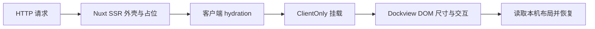

# Vue 与 Nuxt 3 SSR 兼容验证

## 支持边界

这里的 SSR 支持是 **服务端输出稳定外壳，浏览器挂载可拖拽工作台**，不是在服务器上渲染完整 Dockview 面板树。面板布局依赖 DOM 尺寸与浏览器事件，服务端没有视口、ResizeObserver 或 localStorage。使用 `ClientOnly` 不等于整个页面关闭 SSR。

- Vue Node SSR：`scripts/test-vue-ssr.mjs` 在没有 window/document/localStorage 的进程里用真实 `App.vue` 调用 `renderToString`，断言 shell 存在且没有已挂载标签。此项已经通过。
- Nuxt 3 fixture：`examples/nuxt3` 锁定 Nuxt 3.20.2，`ssr: true`；正文外壳在服务器渲染，`.client.vue` 包装器把 Dockview 导入限制在客户端。
- `ClientOnly` 的 fallback 在服务端与初始客户端使用同一份稳定标记，预留工作台高度。CSS 放在 Nuxt 全局 `css`，避免 client-only 插槽样式被服务器构建裁剪。
- localStorage 仅在 Dockview ready 后读取；每次组件实例独立建模，不能在模块顶层建立全局用户布局，防止 SSR 请求之间串状态。



## 本地命令

根项目先 `npm ci`，然后：

```bash
npm run test:ssr
cd examples/nuxt3
npm ci
npm run build
PORT=3100 HOST=127.0.0.1 npm run preview
# 另一终端：
npm run test:ssr
# 停止 preview 后（测试会自动启动生产服务器）：
npx playwright install chromium
npm run test:hydration
```

固定依赖版本在 fixture/package.json，并提交独立 package-lock.json，安装用 `npm ci`。Vue 与 server-renderer 通过 overrides 固定为同一版本，避免混用版本导致 Nitro 产物缺依赖。独立 fixture 复用根 `src`，不要单独复制该目录后运行；根依赖与 fixture 依赖都需要安装。

## 测试各自证明什么

| 检查 | 能证明 | 不能证明 |
|---|---|---|
| Vue Node `renderToString` | 真实 App 的服务器导入与 render 不访问浏览器全局 | 浏览器 hydration、拖拽、GPU |
| Nuxt production build | 服务端和客户端 bundle 可以构建 | 页面实际响应与交互 |
| `tests/server-response.mjs` | 3 次 HTTP 响应为 200、SSR shell/fallback 存在、未输出 dock tabs | hydration 正确性 |
| `tests/hydration.spec.js` | shell 挂载至 6 个标签、添加后刷新恢复、无页面错误或 hydration 告警 | 每个浏览器、触摸拖拽和 GPU 收益 |

不通过 `data-allow-mismatch` 或静默过滤告警来隐藏问题。任何测试只在执行成功后记为通过。

## 实测记录（2026-11-18）

- Vue 3.5.24：Node 环境真实 App 的 SSR render 通过。
- Nuxt 3.20.2 production build：通过；SSR 页面连续 3 次返回 200，保留 shell + fallback，不提前输出 Dockview 标签。
- Chromium / Playwright 1.56.1：hydration 测试 **1/1 通过**，初始 6 个标签，新增为 7 个，刷新恢复为 7 个，无 pageerror 或 hydration/mismatch 告警。
- 本次使用 `PLAYWRIGHT_BROWSERS_PATH=/tmp/pw-browsers` 指向已安装浏览器。通常本机执行 `npx playwright install chromium` 后无需此环境变量。
- 构建存在大 chunk 警告（工作台客户端 bundle 约 575 kB 未压缩）；client-only 不是减小下载体积的保证。工作台路由按需加载，业务图表等重型面板还应进一步延迟导入。
- 未验证 Safari、Firefox、移动端；也不代表完整面板服务端渲染。GitHub Pages 只展示根 Vue 静态 demo，Nuxt SSR 需要 Node/Nitro 服务部署。

## 参考

- [Vue SSR](https://vuejs.org/guide/scaling-up/ssr)
- [Nuxt 3 ClientOnly](https://nuxt.com/docs/3.x/api/components/client-only)
- [Nuxt 3.20.2](https://github.com/nuxt/nuxt/releases/tag/v3.20.2)
